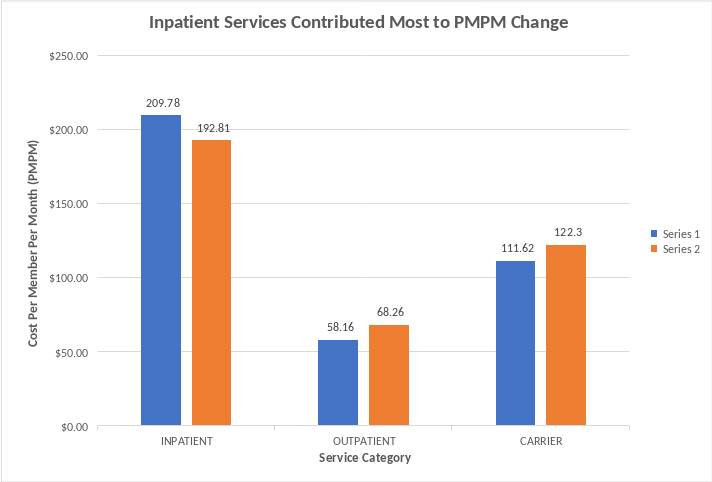

# Medicare PMPM and Trend Analysis

## Introduction

How much did medical costs grow from 2008 to 2009 for a group of Medicare beneficiaries. Was that growth driven by increased frequency of care or increased cost of receiving care?

This project answers these 2 questions using Structured Query Language (SQL), Microsoft Excel, and Centers for Medicare & Medicaid Services' (CMS) synthetic Medicare claims data (DE-SynPUF).

<mark>**NOTE**</mark>: _CMS DE-SynPUF data is synthetic. It is designed to look similar to real Medicare claims data without describing real patients, which could affect patient-physician confidentiality. This project is designed purely to demonstrate data analytic methodologies. These results are not findings about real Medicare costs._

## Motivation

Health insurance premiums are determined months before the year they cover. Analysts may only have claims data from previous years at their disposal to accurately calculate premiums; therefore, they must project claims forward using trend (i.e., expected yearly change in cost per member).

Furthermore, it is also important to know why costs changed. For example, if members are using more care (i.e., increased utilization), then the response should including avoidable hospital stays via preventative care. If healthcare services cost more (i.e., increased unit costs), then the response should include price negotiation via provider contracts.

This project measures the change in fee-for-service (FFS) Medicare from 2008 to 2009, splits the change in costs for inpatient services into utilization and unit costs, and project the PMPM for 2011.

## Definitions

| Term | Definition |
| --- | --- |
| **Member Month** | One covered individual enrolled in an insurance plan for one month |
| **Per Member Per Month (PMPM)** | Average cost per member for each month of coverage. Used to compare groups of differing sizes/coverage periods |
| **Utilization** | How much care members use |
| **Admissions per 1,000** | Hospital admissions per 1,000 members |
| **Unit Cost** | Price per unit of care |
| **Trend** | Percentage change from one year to the next year |
| **Fee-For-Service (FFS)** | Medical care structure in which healthcare providers are paid for each medical service they provide | 
| **HMO/Medicare Advantage** | Medical care structure in which patients subscribe to a network healthcare professionals that coordinate the services that the patient receives |
| **Credibility** | How much weight is given to the subject data compared to outside data |

## Data

**Source:** [CMS DE-SynPUF](https://www.cms.gov/Research-Statistics-Data-and-Systems/Downloadable-Public-Use-Files/SynPUFs/DE_Syn_PUF), Sample 5 (one of 20 independent samples).

| File | Loaded as table | What it holds |
| --- | --- | --- |
| 2008 Beneficiary Summary File | `bene2008` | One row per member: coverage months, demographics, annual payments |
| 2009 Beneficiary Summary File | `bene2009` | One row per member: coverage months, demographics, annual payments |
| 2008–2010 Inpatient Claims | `inpatient` | One row per hospital claim |

**Relevant Columns**

| Column | Meaning |
| --- | --- |
| `DESYNPUF_ID` | Synthetic member ID; links beneficiary and claims tables |
| `BENE_HI_CVRAGE_TOT_MONS` | Months of Part A (hospital) coverage |
| `BENE_SMI_CVRAGE_TOT_MONS` | Months of Part B (medical) coverage |
| `BENE_HMO_CVRAGE_TOT_MONS` | Months in an HMO (Medicare Advantage) |
| `MEDREIMB_IP`, `MEDREIMB_OP`, `MEDREIMB_CAR` | Annual Medicare FFS payments: inpatient, outpatient, and carrier |
| `CLM_ID` | Claim identifier |
| `CLM_FROM_DT` | First day of service (Date format YYYYMMDD) |
| `CLM_PMT_AMT` | Amount Medicare paid on the claim |

## Methodology

### (1) Check Data and Define Study Population

**Check the 2008 Beneficiary File**

This query runs 5 data checks on the 2008 beneficiary file. It first compares the total number of rows with the number of unique member IDs. If the two counts match, each member appears only once. It then counts how many members:

- Have different numbers of months of Part A (hospital insurance) and Part B (medical insurance) coverage
- Have no Part A coverage at all
- Spent at least one month in an HMO (Medicare Advantage) plan
- Have a negative reimbursement amount

**Check the 2009 Beneficiary File**

This query runs 5 data checks on the 2009 beneficiary file. It first compares the total number of rows with the number of unique member IDs. If the two counts match, each member appears only once. It then counts how many members:

- Have different numbers of months of Part A (hospital insurance) and Part B (medical insurance) coverage
- Have no Part A coverage at all
- Spent at least one month in an HMO (Medicare Advantage) plan
- Have a negative reimbursement amount

**Check the Inpatient Claims File**

This query runs 4 checks on the inpatient claims file. It compares the total number of rows with the number of unique claim IDs; if they match, then each claim appears only once. It then finds the earliest and latest claim start (“from”) dates, which show the period the file covers. Last, it checks whether any claim has a negative payment amount.

**Combine the 2008 and 2009 Beneficiary Files**

This query builds the main study table. From each year’s beneficiary file, it selects the member ID, the year, member months (months of Part A coverage), and inpatient, outpatient, and carrier reimbursement. It keeps only members with no HMO months, at least one month of Part A coverage, and equal Part A and Part B months. The `UNION ALL` function then stacks the 2008 rows on top of the 2009 rows. The result has one row per member per year, so a member enrolled in both years appears twice.

### (2) Calculate Member Months

**Calculate Member Months**

For each year, this query counts the members, adds their member months, and calculates the average member months per member. The average shows how many months of the year the average member was covered (e.g., 12 means full-year coverage)

### (3) Calculate PMPM By Service Category

**Calculate PMPM by Service Category**

For each year, this query counts the members and adds member months and inpatient, outpatient, and carrier reimbursement. It then divides each category’s total reimbursement by total member months. That gives the cost per member per month (PMPM) for each category. The results are then grouped and sorted by year.

### (4) Calculate Inpatient Admissions and Cost per Admission

**Create an Inpatient View**

This query creates a view (i.e., a saved query) that later steps can use similar to a table. From the inpatient claims file, it pulls each member’s ID and the year each claim started, taken from the claim’s from date. For each member and claim start year, it counts admissions and adds up inpatient claim payments. The result has one row per member per year with at least one inpatient stay.

**Calculate Cost per Admission**

This query joins the main table to the inpatient view with a `LEFT JOIN`, matching on member ID and year. A `LEFT JOIN` keeps every member in the main table, including members with no admissions. It also leaves out inpatient claims for anyone the main table excluded. For each year, the query adds up member months, admissions, and inpatient claim payments. It then divides total payments by total admissions to get the cost per admission.

### (5) Trend Split
### (6) Projection

## Results

### Study population
 
| | 2008 | 2009 |
| --- | --- | --- |
| Members kept | 78,002 | 72,629 |
| Member months | 910,678 | 870,883 |
| Average months per member | 11.68 | 11.99 |
 
### PMPM by service category
 
| Category | 2008 PMPM | 2009 PMPM | Trend | Share of total change |
| --- | --- | --- | --- | --- |
| Inpatient | $209.78 |	$192.81 |	-8.09%	|	-445.41% |
| Outpatient | $58.16 |	$68.26 |	17.37% |	265.09% |
| Carrier | $111.62 |	$122.30 |	9.57%	| 280.31% |
| **Total** | $379.56 |	$383.37 |	1.00% | 100% |

 
### Inpatient: utilization vs. unit cost
 
| Measure | 2008 | 2009 | Trend |
| --- | --- | --- | --- |
| Admissions per 1,000 (annual) | 265.1475055 |	234.7548408 |	-11.46% |
| Cost per admission | $9,470.55 |	$9,661.32 |	2.01%
| Inpatient PMPM | $209.26 |	$189.00 |	-9.68%

### Projection
 
| Input | Value |
| --- | --- |
| 2009 total PMPM | $383.37  |
| Observed trend (2008→2009) | 1.00% |
| Benchmark trend (Medicare per enrollee, 2009) | 5.40% |
| Credibility weight Z | 0.25 |
| Selected trend | 4.30% |
| **Projected 2011 PMPM** | **$417.06** |

## Reasoning

## Limitations
- This CMS dataset is synthetic, meaning it does not represent actual patients and claims. Any calculations cannot be applied to a real-world Medicare pricing
- Calculations are based on one-year of trend from one CMS sample
- There is no IBNR adjustment, meaning calculations do not allow for any claims that have been incurred but not reported

## Skills Utilized
 
- **SQL:** data-quality checks, filtering, `UNION ALL`, `CREATE TABLE AS`, aggregation, `LEFT JOIN` to a summarized subquery, reconciliation between sources
- **Excel:** trend analysis, decomposition formulas, credibility-weighted trend selection, sensitivity tables, charts
- **Health actuarial concepts:** claims data, member months, PMPM, utilization per 1,000, unit cost, trend, cost projection
